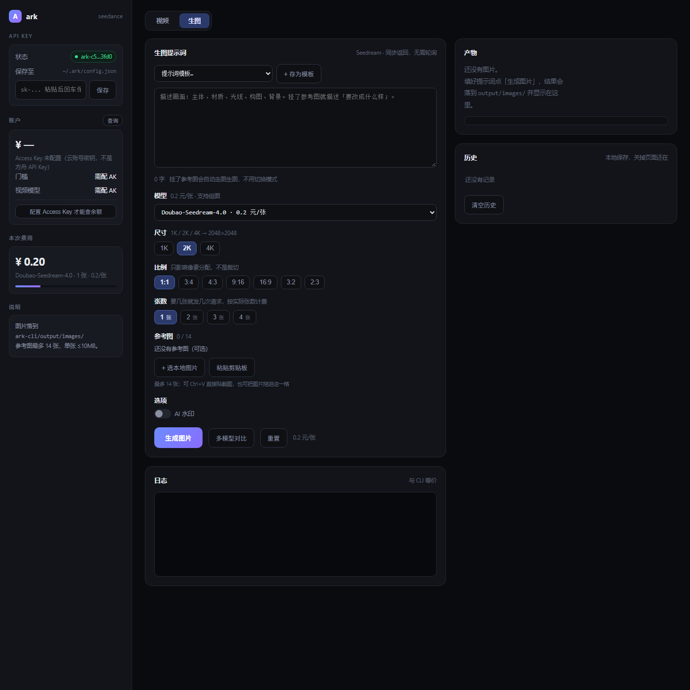

# ark-cli

> 火山方舟 Seedance / Seedream 的本地出片控制台。一条命令出视频，一个网页比模型。


```bash
ark video "夜晚东京街头，霓虹倒影，镜头缓慢推进" -R 480p -d 5   # 建任务 → 轮询 → 下载
ark ui                                                          # 起本地网页控制台
```

支持 Seedance 2.5 文生视频 / 图生视频 / 首尾帧 / 参考图 / 参考视频 / 视频编辑 / 视频延长 / 样片，
以及 Seedream 4.0–5.0 文生图 / 图生图 / 多模型对比出图。



## 为什么写这个

官方的方舟控制台是「填参数 → 点提交 → 等结果」的单次调用页。真做片子的时候会撞上四堵墙：

1. **比模型要开四个标签页**，同一个提示词手填四遍，参数还得记住哪个模型支持哪档尺寸
2. **素材限制靠试错发现**：64MB 请求体上限、参考视频 2–30s、编辑任务 4–30s、宽高比 0.4–2.5，跑到一半才 400
3. **失败不便宜**：一条 8 秒 1080p 要 30 元，参数写错或素材不合规，钱照扣
4. **成本是黑箱**：出片前不知道要花多少，出完不知道余额还能撑几条

所以这里做的不是「再包一层 API」，而是把出片做成流水线——**参数先校验、素材先预检、成本先算清、结果落本地**。

## 三个设计取舍

**零依赖。** 没有 SDK、没有前端框架、没有构建步骤。火山签名 v4 用 `node:crypto` 手写（`src/sign.js`），
HTTP 用 Node 内置 `fetch`，网页是单个 `index.html`。克隆下来 `node bin/ark.js` 就能跑，不存在依赖腐烂。

**双入口同源。** CLI 和网页共享 `src/` 下的同一套参数校验与请求组装代码，网页只是外壳。
CLI 里能做的事，网页里一定也能做；网页里新增的能力，CLI 同步具备——不会出现「前端新、后端旧」的错位。

**可验证。** `--selftest` 29 条离线断言覆盖模型解析、请求体组装、生图尺寸、预设优先级、编辑任务约束；
`--dry-run` 只打印请求体、不发请求、不花钱。新功能如果过不了这两条路，就不算完成。

```bash
node bin/ark.js --selftest      # 29/29 通过，不需要网络和 Key
node bin/ark.js video "测试" --dry-run
```

## 这个仓库里还有什么

`docs/skill/` 是一份可直接喂给 AI Agent 的 **Skill 定义**（`SKILL.md` + 7 篇 reference）：
把「怎么从零搭一套这样的控制台」写成可执行流程——事实采集优先于写代码、验收门先定、
29 条断言作为唯一的回归保护。

也就是说，这个仓库同时是两样东西：一个能用的工具，和一份能教会 AI 复刻它的说明书。

## 安装

需要 Node.js ≥ 18。不需要 `npm install`，本项目零依赖。

```bash
cd ark-cli
npm link            # 全局注册 ark 命令（也可直接 node bin/ark.js ...）
```

## 配置 API Key

1. 打开 https://console.volcengine.com/ark/region:ark+cn-beijing/overview ，先完成**实名认证**
2. **账户充值**：视频模型开通要求**账户可用余额达到 200 元**（首页右上「账户充值」，规则见下一节）
3. 左侧 **开通管理 → 视觉模型**，逐个点开通 `Doubao-Seedance-2.5`（可勾「全选及自动开通新增模型」）
4. 左侧 **API Key 管理 → 创建 API Key**，复制
5. 存进本地：

```bash
ark config set api-key sk-你的key
# 或者：export ARK_API_KEY=sk-...
```

> Key 存在 `~/.ark/config.json`，权限 600，不进仓库。

## 200 元门槛到底是什么

**不是充值套餐，也不是「买一次全场通票」，而是视频模型的开通保证金。**

| 问题 | 官方规则 |
|---|---|
| 200 元是费用吗 | 不是。它是「可用余额需达到 200」的**开通条件**，钱还在你账上，按量后付费实时扣 |
| 覆盖哪些模型 | 只覆盖 **Seedance 视频系列**：2.5 / 2.0 / 2.0-fast / 2.0-mini |
| 其他模型要吗 | **不要**。语言（Doubao-Seed）、图像（Seedream）、语音都是开通即用，各有免费额度：文本 50 万 token/模型、Seedream 50–200 张、TTS 5000 字符 |
| 充一次能开几个 | 一个账号充 200 元，同时满足整个 Seedance 系列的开通条件；但**每个模型仍要在「开通管理」里单独点开通** |
| 能提现吗 | 模型处于开通状态时，余额中**不超过 200 元的部分锁定不可提现**；关闭模型实例后可提现 |
| 200 元能用多久 | 纯 480p 无声约 297 秒成片 ≈ 37 条 8 秒片（0.672 元/秒）；1080p 只够 53 秒 |

三种满足门槛的方式（任选其一，不必都买）：

| 方式 | 门槛 | 有效期 | 适用范围 |
|---|---|---|---|
| 账户余额（推荐） | 可用余额 ≥ 200 元 | 长期 | 可抵扣火山引擎全部产品 |
| 节省计划 | 买 ≥200 元专属递减型 | 200 元档 30 天；500/1000 元档 90 天 | 抵扣方舟**全部**模型（含语言/图像/语音） |
| 资源包 | 买 ≥200 元模型资源包且有余额 | 90 天 | **只抵单一模型** |

> 官方没有写明「余额跌破 200 会自动停用」；已开通的实例一般保留，但余额不足时请求会扣费失败。留 20–50 元余量最稳。
> 少数模型处于「邀测中」，无法自助开通，只能提工单。

### 其他模型会不会吃掉这 200 元

**会。那 200 元是账户通用余额，不是视频专用押金**——只要模型处于「已开通」状态且赠送额度用完，任何方舟模型都从同一个钱包扣。

| 模型状态 | 免费额度用完之后 | 动余额吗 |
|---|---|---|
| **未开通**（默认） | 调用被拒，提示额度已耗尽 | **不动**，停住 |
| **已开通**（你点了开通 / 勾了「自动开通新增模型」） | 自动转按量后付费 | **会扣**，扣到 0 为止 |
| 安心体验模式开启 | 接近额度即暂停服务 | 不动，但**视频模型也会一起停**，等于没法出片 |

所以防扣钱只有两招：

1. **只开通 Seedance，其他模型一律留在「未开通」**——用完白嫖额度就自然停，不会扣钱。
2. 给已开通的模型设**模型用量上限**（开通管理页），到上限自动暂停服务。

`ark account`（待实现）就是用来一眼看余额、开通状态和剩余免费额度的。

> 免费额度只抵 token/张数/字符，**抵不了联网插件、知识库**这类调用；开了这些即使有额度也会照常计费。

## 账户体检（`ark account`）

余额和开通状态**只能拿 Access Key 查**，方舟 API Key 不行——前者是云账号凭证，后者只够调模型。

```bash
# 一次性配置（AK/SK 存 ~/.ark/config.json，权限 600）
ark config set access-key <AK>
ark config set secret-key <SK>

ark account          # 余额 + 门槛 + 每个视频模型的开通状态与免费额度
ark account --json   # 同一份数据，给脚本/网页用
```

Access Key 在 https://console.volcengine.com/iam/keymanage 创建（建议建 IAM 子用户并只授予方舟权限，别用主账号 AK）。

输出长这样：

```
凭证      ~/.ark/config.json
账户      2100xxxxxx · CNY
可用余额  ¥ 213.50
明细      现金 213.50 · 冻结 0.00 · 欠费 0.00 · 信控 0.00
开通门槛  ✅ 可用余额 ≥ 200 元（余量 ¥13.50）
锁定      其中 ¥200.00 在模型开通期间不可提现
出片能力  ≈ 317 秒 480p 成片（约 39 条 8 秒片）

模型开通
  ✅ Doubao-Seedance-2.5      已开通   免费额度 —
  ⬜ Doubao-Seedance-2.0      未开通   免费额度 —
```

实现上不依赖任何 SDK：`src/sign.js` 用 `node:crypto` 实现了火山签名 v4（`Credential=<AK>/<date>/cn-beijing/<service>/request`），
分别打费用中心的 `QueryBalanceAcct`（`service=billing`）和方舟管控面的 `ListModelActivations`（`service=ark`），
两条链路任一失败都会保留另一部分结果，不会整条命令挂掉。

网页控制台左侧也有一张「账户」卡，点「查询」拉同一份数据。

## 出第一条视频

```bash
# 最省：8 秒 480p 无声，约 5.4 元
ark video "一只橘猫在草地上追蝴蝶，阳光透过滤叶，慢镜头" -R 480p -d 8 --mute

# 图生视频（首帧）
ark video "女孩睁开眼睛，温柔地看向镜头" -i ./girl.png -R 480p -d 5

# 首尾帧衔接
ark video "镜头从日出推进到日落" -i sunrise.png --last-frame sunset.png

# 视频编辑（删掉 BGM）
ark video "去掉背景音乐" --video ./clip.mp4 --task-type edit

# 先试片再出正式片：样片模式只出 480p
ark video "产品旋转展示" --draft -d 5
```

产物落在 `./output/<提示词>-<时间戳>.mp4`。

## 常用命令

| 命令 | 作用 |
|---|---|
| `ark ui` | **启动本地网页控制台**，浏览器里填提示词点按钮出片 |
| `ark video "<提示词>" [选项]` | 建任务 → 轮询 → 下载 |
| `ark tasks` | 查云端任务列表（关掉页面也还在） |
| `ark task <任务ID>` | 查询/继续等待某个任务 |
| `ark cancel <任务ID>` | 取消排队中的任务 / 删除记录 |
| `ark models` | 列出模型、Model ID、分辨率、时长、单价 |
| `ark account` | **查真实余额、200 元门槛、各模型开通状态与免费额度**（需 Access Key） |
| `ark cost -R 480p -d 8` | 只算钱，不发请求 |
| `ark config set api-key <KEY>` | 保存 Key |
| `ark video ... --dry-run` | 打印请求体，不真发 |
| `npm run selftest` | 离线自检（16 项断言） |

`ark video --help` 有完整参数表（含高级选项）：

| 高级参数 | 作用 |
|---|---|
| `--seed 42` | 固定随机种子，同参数可复现 |
| `--camera-fixed` | 锁定机位 |
| `--output-format mov` | 输出 mov（H.264+yuv444p，编辑/延长推荐） |
| `--return-last-frame` | 同时返回尾帧图，拼接下一段 |
| `--callback-url <URL>` | Webhook 回调，替代轮询 |
| `--expires 7200` | 任务超时阈值（秒，3600–259200） |
| `--priority 3` | 调度优先级 0–9 |
| `--safety-id <值>` | 终端用户标识 |
| `--draft-from <任务ID>` | 用样片出正式片 |

## 样片两段式（省钱打法）

```bash
ark video "产品旋转展示" --draft -d 5        # 480p 样片，先看构图动作
ark video --draft-from cgt-xxxx              # 满意后用样片 ID 出正式片
```

网页上更直接：样片出片后，结果卡片会冒出「用这个样片出正式片」按钮。

## 网页控制台

```bash
ark ui            # 默认 http://127.0.0.1:5173
ark ui --open     # 启动后自动用默认浏览器打开
```

**Windows 双击就能用**：项目根目录的 `start-ui.bat`，固定 5199 端口、自动开浏览器，关窗口即停止。

**重复启动会复用已有实例，不再偷偷换端口**：如果目标端口上已经有一个 ark 控制台在跑，第二次启动只打印它的地址、pid 和模型数量，然后退出——
不会再起第二个进程，也不会把浏览器带到另一个端口上。

> 这条是踩过坑的：旧版本遇到端口占用会静默 `+1` 并打开浏览器，结果是"浏览器里是新前端、服务端跑的是旧代码"，
> 页面上怎么看都少一个模型，实际是连到了另一个进程。现在端口被占用只有两种结果：**复用**（占用者是 ark）或**明确提示换端口**（占用者是别的程序）。

页面左侧「运行状态」卡片里有一行 **实例**：`127.0.0.1:5199 · pid 127700 · 14:24 启动`。
看到它就能确认自己连的是哪个进程；模型没更新时先看这行，比翻代码快。

控制台是本地服务，不是网页托管：**每次用之前要先把它启动起来**，退出终端（或关掉那个黑窗口）服务就停了，再访问会显示无法连接。
想让它常驻可以建一个快捷方式把它放到启动目录，或者用 `start /min` 后台跑。

浏览器里可以做：填提示词、选分辨率/时长/画幅（每个按钮带单价，时长支持「+ 自定义」输入 4–30 之间任意秒数）、拖入首帧尾帧图、
上传参考图（≤30 张）、选本地参考视频/参考音频或填其公网 URL、选任务类型（参考生视频/视频编辑/视频延长）、
开关音频与样片模式、实时看任务状态与耗时、产物直接在页面里播放并可下载。
左下角能直接粘贴保存 API Key，不用回终端。

顶部有「视频 / 生图」两个 tab，生图那一半见下面的「生图（Seedream）」一节。

参考视频/音频区的入口在区块标题右侧（「+ 选本地视频」/「+ 选本地音频」），也可以直接把文件拖进那一块。
加进来的条目点一下就地展开播放器预览，右侧显示「本地/URL · 文件大小」，点 `×` 移除。

**提示词模板与内置预设**：下拉里分两组。「内置预设」是白模参考 / 绿幕生成 / 绿幕换实景三条，
选中会同时套用提示词骨架和参数（任务类型、画幅、时长、原生音频、输出格式），日志里会列出改了哪几项，
高级参数区会自动展开；这三条不可删除也不可覆盖，要改成自己的版本就点「+ 存为模板」另存。
「我的模板」是你自己存的，同名再存会更新内容，「删除」移除选中项。
模板存在浏览器 `localStorage`（`ark.templates.v1`），只在本机、不上传、不进仓库。

**参考视频预检**：加进来的视频会立刻调本机 `ffprobe` 读参数，右侧显示 `12s · 1080×1920 · 30fps ✓`
这样的徽标，超出官方限制会标红并列出原因。细节见下面的「白模参考与绿幕编辑」。

控制台和 CLI 走同一套 `src/` 代码，`ark ui` 只是外壳。

### 参考素材的两种传法

| 素材 | 网页 | CLI | 建议 |
|---|---|---|---|
| 首帧 / 尾帧 | 拖入图片 | `-i` / `--last-frame` | 本地文件走 base64，≤30MB |
| 参考图 | 点「+ 添加」多选 | `-r` 可重复 | ≤30 张，多了用 URL |
| 参考视频 | 标题行「+ 选本地视频」（≤10MB）或拖入，也可填 URL | `--video` 可重复 | **大文件必须 URL**：请求体上限 64MB |
| 参考音频 | 标题行「+ 选本地音频」（≤10MB）或拖入，也可填 URL | `--audio` 可重复 | 同上 |

> 本地视频走 base64 会撑爆 64MB 上限，正确做法是先传到对象存储（火山 TOS / OSS / 任意图床）拿公网直链。
> Seedance 2.5 不支持含真人人脸的参考图/视频。

## 生图（Seedream）

视频页是「提交任务 → 轮询 → 下载」，生图是**同步接口**：一次请求等到图，没有任务 ID、不用轮询。

```bash
# 文生图
ark image "一只绿色奶蛙玩偶，纯白背景，柔和顶光，产品摄影" --size 2K --ratio 1:1
ark image "同上" --size 2K --ratio 9:16        # 1152x2048，竖屏
ark image "四种配色的奶蛙" -n 4               # 连发 4 次，实打实 4 张

# 图生图（给参考图就自动走，不用切模式）
ark image "保持造型，把背景换成浅灰渐变" --ref ./奶蛙.png
ark image "把图1的服装换成图2的" --ref a.png --ref b.png

# 多模型对比：同一提示词并行调多个模型，各出 1 张
ark image "奶蛙玩偶，纯白背景" --compare seedream-4.0,seedream-4.5 --size 1K

# 只拼请求体，不发请求也不花钱
ark image "测试" --dry-run
```

| 参数 | 说明 |
|---|---|
| `-m, --model` | `seedream-4.0`（默认）\| `4.5` \| `5.0-flash` \| `5.0-lite` \| `5.0-pro` \| 完整 Model ID |
| `--size` | `1K` / `1.5K` / `2K`（默认）/ `3K` / `4K`，按模型能力；也可直接写 `2048x1152` |
| `--ratio` | `1:1`（默认）/ `3:4` / `4:3` / `9:16` / `16:9` / `3:2` / `2:3`，只用来折算短边像素 |
| `-n, --n` | 1–15；>1 时**按张连发**（平台一次只保证 1 张），耗时线性增加 |
| `--compare` | 多模型对比，逗号分隔，至少 2 个；未开通的模型会单独报失败，不影响其他 |
| `-r, --ref` | 参考图，可重复，≤14 张，单张 ≤10MB |
| `--watermark` | 加「AI生成」水印 |
| `-o, --out` | 落盘目录，默认 `./output/images` |

**尺寸怎么来的**：档位是「长边」，短边按比例折算，再夹到官方允许的像素区间（1280x720 ~ 4096x4096）。
所以 `1K + 9:16` 不会给你 576x1024，会自动放大到 720x1280。

| 模型 | 元/张 | 尺寸档 | 输出格式 | 组图 |
|---|---|---|---|---|
| `seedream-4.0` | 0.20 | 1K/2K/4K | jpeg | ✅ |
| `seedream-4.5` | 0.25 | 2K/4K | jpeg | ✅ |
| `seedream-5.0-flash` | 0.12 | 1K/1.5K/2K | png/jpeg | ❌ |
| `seedream-5.0-lite` | 0.22 | 2K/3K/4K | png/jpeg | ✅ |
| `seedream-5.0-pro` | 0.30 起 | 1K/1.5K/2K | png/jpeg | ❌ |

**5.0 的三条线是独立产品，不是同一模型的档位**：flash 最快最便宜（0.12），pro 画质优先（0.30 起），lite 支持组图。
Model ID 也完全不同（`-5-0-flash-260915` / `-5-0-pro-260628` / `-5-0-260128`），别互相套。

输入图不计费，只按实际输出的张数算。

**实测踩到的坑**（真机验证，不是推测）：

1. `doubao-seedream-4-0-250828` 已下线 → 404；当前主线是 `doubao-seedream-4-0-20260415`。
2. **接口会静默忽略不认识的参数**——塞一个 `__bogus_param__` 照样 200 出图。所以「不报错」不等于「生效」，
   任何参数只能靠结果验证。据此实测：
   - `seed`：同 seed 连发两次，图片 sha256 完全不同 → **不可复现，别指望用 seed 锁构图**。
   - `sequential_image_generation` / `max_images`：新旧写法都只返回 1 张 → 张数改成**客户端连发**。
   - `output_format`：4.0 直接 400 `not supported by the current model`；png 只有 5.0 系列支持。
3. **`sequential_image_generation` 对 5.0 pro / flash 是硬错误**：连 `"disabled"` 都不接受，返回
   `400 ... is not supported by the current model`。`buildImagePayload` 已按模型能力决定是否带这个字段。
4. **开通状态 ≠ 模型存在**：控制台显示「已开通」只代表账号有权限，本地模型表里没有就不会出现在下拉。
   补一条 `models.js`，或直接在下拉里选「＋ 自定义 Model ID」填完整 ID 临时用。

**404 的模型会被记住**：网页里某个模型报 404 后，下拉框会标上「未开通」并自动切到可用模型，
标记存在浏览器 `ark.image.unavailable.v1`，下次打开还在；等真的开通了、成功出一次图，标记自动消失。
所以看到 404 不用去翻文档猜，直接去控制台开通或换模型即可。

网页另一半：`ark ui` 打开后点顶部「生图」tab，参数与 CLI 一致，另外还有：

- **提示词模板**：独立存一套（`ark.templates.image.v1`），和视频模板互不干扰
- **三种传图方式**：按钮选文件、`Ctrl+V` 直接贴剪贴板、把图拖进参考图格
- **产物三连**：每张图下方可「以此为参考」继续改、「用作视频首帧」、「用作视频参考图」（后两个自动切到视频页并填好槽位）
- **多模型对比**：勾 2–4 个模型并行出图，横向比效果（未开通的会单独标失败）
- **历史记录**：提示词 + 模型 + 尺寸 + 张数 + 费用，点一条即可回填重跑

**视频页代码未改动**，两套逻辑互不影响。

## 白模参考与绿幕编辑

Seedance 2.5 支持「白模参考」和「绿幕参考」，但 **API 没有专门参数**——`omni_reference_task_type` 只有 `auto / reference / edit / extend` 四个取值，`content.role` 只有 `first_frame / last_frame / reference_image / reference_video / reference_audio`。白模和绿幕都是「普通参考视频 + 特定写法的提示词」，靠模型语义识别。

所以这里做的是**预设**：把参数搭配、提示词骨架、素材要求固定下来，一键套用。

| 预设 | 用途 | 自动设置的参数 |
|---|---|---|
| `clay` 白模参考 | 3D 白模预演 → 实拍质感成片 | 参考生视频 · 画幅 adaptive · 时长跟随 · 关音频 · 输出 mov |
| `green-gen` 绿幕生成 | 出带纯绿背景的可抠像素材 | 自动判定 · 关音频 · 输出 mov（分辨率和时长自己定） |
| `green-edit` 绿幕换实景 | 绿幕素材补全环境，直接出成片 | 视频编辑 · 画幅 adaptive · 时长跟随 · 关音频 · 输出 mov |

```bash
# 白模：提示词留空，自动用骨架
ark video --preset clay --video ./白模.mp4 -R 720p

# 绿幕生成：提示词自己写主体和动作
ark video "五只奶蛙端着蛋糕直立行走" --preset green-gen -R 720p

# 绿幕换实景
ark video --preset green-edit --video ./green.mp4 -R 720p
```

显式写的 flag 永远优先于预设。也认中文别名 `白模` / `绿幕`。网页里在提示词框下方的下拉选「内置预设」，选中后提示词骨架和参数会一起套用，高级参数区会自动展开，日志里会列出改了哪几项。

预设默认关闭原生音频，要开加 `--with-audio`（网页里勾「生成原生音频」）。内置预设不能删除或覆盖，要改就「+ 存为模板」另存一份。

### 两个必须知道的坑

**1. 白模要在导出前清干净辅助元素**

轨迹线、坐标轴、相机锥体、网格会被模型当成场景物体一起渲染进成片，只留几何体本身。另外白模作为参考视频建议 5–10 秒，太长模型抓不住重点。

**2. 绿幕必须输出 mov**

`output_format: mov` 是 H.264 + **yuv444p** 色度采样；mp4 默认 yuv420 会在绿幕边缘产生色度溢出，抠出来一圈绿边。预设已自动切好 mov，不用手动改。

### 素材预检

参考视频加进网页时会调本机 `ffprobe` 读参数，按官方限制判断：

| 检查项 | 要求 |
|---|---|
| 时长 | 普通任务 2–30s，**编辑任务 4–30s** |
| 帧率 | 24–60 fps |
| 宽高比 | 0.4–2.5 |
| 像素总数 | 40.8 万 – 829.5 万 |
| 宽高边长 | 各 300–6000 px |
| 文件大小 | ≤200MB |

每条参考视频右侧会显示 `12s · 1080×1920 · 30fps ✓` 这样的徽标，不合规标红并列出原因。切换任务类型会重新判定（比如切到编辑任务，3 秒的素材就会报不合规）。

本机没有 ffprobe 时预检自动跳过，不影响提交；要指定路径可设 `FFPROBE_PATH` 环境变量。

## 成本参考（Seedance 2.5，16:9）

| 分辨率 | 每秒 | 5s | 8s | 15s |
|---|---|---|---|---|
| 480p | 0.672 元 | 3.36 | 5.38 | 10.08 |
| 720p | 1.512 元 | 7.56 | 12.10 | 22.68 |
| 1080p | 3.742 元 | 18.71 | 29.94 | 56.13 |

按 token 实际结算，`ark video` 跑完会打出真实 token 用量。省钱三招：`--draft` 先试片、`--mute` 关音频、`-R 480p` 出草稿。

## 项目结构

```
ark-cli/
├── bin/ark.js          # 入口
├── src/
│   ├── cli.js          # 参数解析 + 校验 + 命令
│   ├── ark.js          # HTTP：组 content / 建任务 / 轮询 / 下载
│   ├── models.js       # 模型 ID 与价格（唯一事实来源）
│   ├── config.js       # ~/.ark/config.json
│   ├── account.js      # 余额 / 开通状态体检（AK-SK）
│   ├── sign.js         # 火山签名 v4（HMAC-SHA256，零依赖）
│   ├── presets.js      # 白模/绿幕预设（提示词骨架 + 参数，网页与 CLI 共用）
│   ├── probe.js        # 参考视频预检（调 ffprobe，按官方限制判断）
│   └── server.js       # ark ui 的本地 HTTP 服务（零依赖）
├── web/index.html      # 网页控制台（单文件，无构建）
├── start-ui.bat        # Windows 双击启动控制台（5199 端口 + 自动开浏览器）
├── docs/
│   ├── seedance-2-5.md # 官方文档摘要（视频，给 AI 读的）
│   ├── seedream.md     # 官方文档摘要（生图，给 AI 读的）
│   └── 把文档喂给AI.md  # 怎么用 AI 继续维护这个项目
└── AGENTS.md           # AI 编码代理的约定
```

维护方式见 `AGENTS.md`；加新模型只需改 `models.js` + 加一份 `docs/<model>.md`。

## 注意

- 密钥存在 `~/.ark/config.json`（权限 600），**不进仓库**。仓库里没有任何 Key。
- 本项目只是本地工具，不代理、不转发你的请求，所有调用直接打火山引擎官方接口。
- 生成内容的合规责任在使用者，请遵守方舟的服务条款与内容规范。

## License

[MIT](LICENSE) © 2026 Meng Sai

